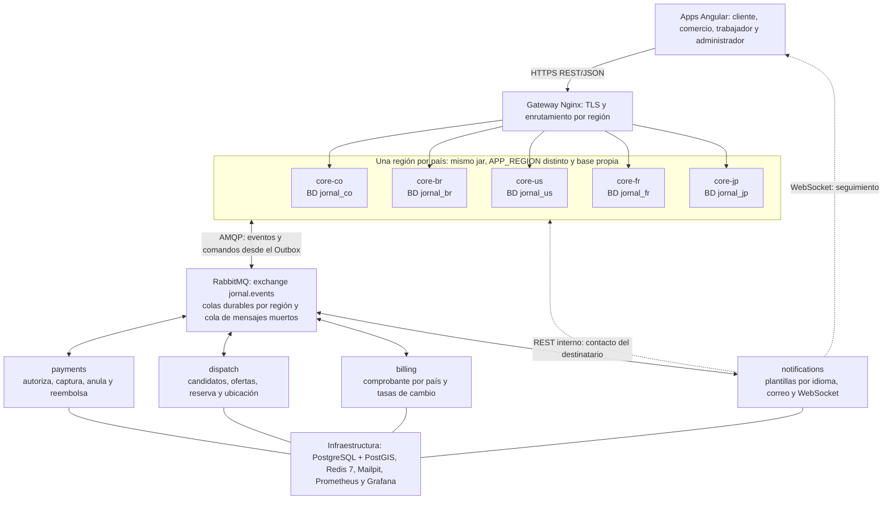
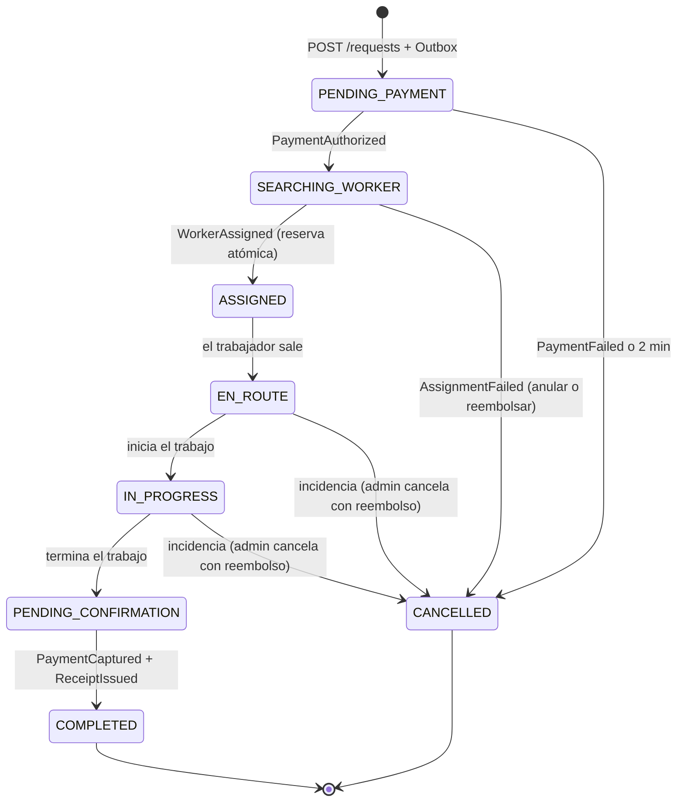

# Jornal — Plan de desarrollo para Claude Code

Fecha: 24/11/2026

## Cómo usar este plan

Este plan lleva el backend Jornal (estado del 24/11/2026) hasta cumplir el proyecto «Diseño de un Sistema Distribuido» de la Universidad Central. Claude Code trabaja fase por fase, en el orden de la sección Fases, y no abre una fase sin cerrar el criterio de terminado de la anterior.

Reglas para Claude Code:

- Lee este documento completo y «Jornal Backend: estado actual» (`docs/ESTADO-ACTUAL.md`) antes de tocar código.
- Respeta las convenciones del proyecto: cada módulo es dueño de sus tablas, UUID sin FK entre módulos, contratos en la raíz del módulo o eventos, DTOs con MapStruct, enum de errores por módulo y paginación máxima de 100.
- Nunca edites una migración aplicada: crea la siguiente, desde V9.
- Prohibido escribir reglas por país en la lógica (`if` o `switch` sobre el código del país). Toda diferencia va en el perfil regional; si un comportamiento cambia, el perfil elige una estrategia por nombre (por ejemplo `validator: "luhn"`).
- Usa un bean `java.time.Clock` para toda hora actual, nunca `Instant.now()` directo: la prueba obligatoria fija la hora.
- No inventes tasas, impuestos ni normas. Carga los valores del enunciado como referencia, con la marca `VERIFICAR` y un campo de fuente, para que el equipo los confirme.
- Todo dato personal de prueba es ficticio.
- Lo marcado «Por confirmar» se pregunta al equipo antes de implementarlo.
- Al cerrar cada fase: pruebas en verde, README actualizado y un commit por fase.

Prioridades: P1 es imprescindible para la sustentación y P2 suma puntos si sobra tiempo. Con poco tiempo, todas las P1 van antes que cualquier P2.

## Punto de partida

Jornal ya resuelve identidad, consentimiento, catálogo de categorías y perfil del trabajador para Colombia, en un monolito modular. Le falta el flujo completo del pedido, los cinco países y la separación en procesos que se comunican por mensajes.

| Área | Jornal hoy | Lo que exige el enunciado (sección) |
| --- | --- | --- |
| Arquitectura | Monolito modular (Spring Modulith) en un solo proceso | 5 instancias regionales en contenedores distintos y al menos 4 subsistemas como procesos independientes con intermediario de mensajes (7.1, 7.3) |
| Países | Solo CO habilitado; BR, US, FR e IT deshabilitados | CO, BR, US, FR y JP con la misma base de código (3) |
| Actores | APPLICANT, WORKER, ADMIN | Cliente, comercio, repartidor y administrador (4) |
| Localización | es-CO y en-US; traducciones del catálogo creadas pero sin usar | 5 idiomas; formatos CLDR; nombres, direcciones, teléfonos, impuestos, propina y comprobante por país (3, 4.1) |
| Pedido | No existe | Carrito, pedido, pago, asignación, seguimiento, comprobante y calificación (4) |
| Pagos | No existe | Medios de cada país (simulados) y reembolso ante cancelación o falla (4) |
| Tiempo real | Dependencia WebSocket sin uso | Seguimiento del pedido y de la ubicación del trabajador (4) |
| Mensajería | Eventos internos de Modulith | Broker con colas durables, reintentos, confirmación y reversión (5, 6.3) |
| Frontend | No existe | Apps de cliente, comercio, repartidor y consola de administración en 5 idiomas (6.4) |
| Pruebas | Modularidad, arranque y dos servicios | Pruebas de falla y prueba de localización de la sección 8 (7.5, 7.6, 8) |

Antes de todo hay que cerrar los 9 problemas de la sección 11 del estado actual; el más grave es el claim `rol` contra `role`, que deja en 403 todo endpoint protegido por rol.

## Decisiones de diseño

Once decisiones fijan el rumbo; cuatro necesitan confirmación del equipo (o del profesor) antes de la fase que las usa.

| ID | Decisión | Motivo | Estado |
| --- | --- | --- | --- |
| D1 | Un solo nombre de producto en código, informe y presentación (hoy: Jornal en el código, Chambas en el informe, «trabajos temporales» en las diapositivas) | El profesor evalúa coherencia entre informe, prototipo y sustentación | Por confirmar |
| D2 | Cliente = APPLICANT (persona); comercio = nuevo rol BUSINESS (tienda o empresa que contrata, con identificación fiscal y factura a su nombre); repartidor = WORKER; administrador = ADMIN | Jornal ya define al solicitante como «personas, tiendas o empresas»; cubre los 4 actores con el menor cambio. Alternativa más costosa: comercio como proveedor de materiales (aliado comercial del informe) | Tomada (24/11/2026) |
| D3 | Países: CO, BR, US, FR y JP; JP entra por migración e IT queda deshabilitado | Las tablas 3.1 a 3.3 del enunciado y el informe usan Japón | Tomada |
| D4 | Pedido de prueba equivalente: 2 unidades de una categoría (por ejemplo, 2 jornadas de bodega) + 1 recargo de desplazamiento + propina | Conserva la estructura del caso «dos almuerzos, un domicilio y una propina»: subtotal, domicilio, impuesto, propina y total | Por confirmar |
| D5 | 5 cores regionales (mismo jar, `APP_REGION` distinto, base de datos propia) + 4 subsistemas independientes (Pagos, Asignación, Notificaciones, Facturación) + RabbitMQ + gateway | Cumple 7.1 y 7.3 sin levantar 25 JVM en un portátil | Tomada |
| D6 | Middleware: RabbitMQ (AMQP 0-9-1) con la externalización de eventos de Spring Modulith y su registro de publicaciones en JPA como Outbox | Es lo que declara el informe; Modulith permite pasar a Kafka por configuración | Tomada |
| D7 | Asignación por oferta automática secuencial: se ofrece al mejor candidato con tiempo límite y, si no acepta, al siguiente | Resuelve la decisión abierta del roadmap y cumple «proximidad, disponibilidad y balanceo de carga» | Tomada |
| D8 | Dinero en enteros (BIGINT) en la unidad menor práctica (COP 0, BRL 2, USD 2, EUR 2, JPY 0) + código ISO 4217; nunca float | Regla 4.1.4 del enunciado y del informe | Tomada |
| D9 | Instantes en UTC (`timestamptz`); el pedido guarda además la zona IANA del lugar del trabajo y se muestra en la zona de quien lo ve | Regla 4.1.5; EE. UU. y Brasil tienen varias zonas | Tomada |
| D10 | JWT RS256 con clave pública (JWKS) en lugar de HS256 compartido | Los subsistemas validan tokens sin conocer el secreto. Respaldo si falta tiempo: HS256 compartido | Tomada |
| D11 | Frontend en Angular, traducciones en tiempo de ejecución (Transloco), `Intl` para formatos y Leaflet con OpenStreetMap para mapas | Encaja con Spring Boot, cambia de idioma sin recompilar y maneja respaldo de traducciones | Por confirmar |

## Arquitectura objetivo

El sistema queda en 9 procesos Java más infraestructura: un core por país y cuatro subsistemas que se hablan por RabbitMQ, con REST interno solo para consultas puntuales.



Las flechas `<-->` pasan por RabbitMQ y las punteadas son el WebSocket de seguimiento y la consulta REST interna del contacto al core de cada región.

### Procesos

| Proceso | Contenido | Datos | Instancias |
| --- | --- | --- | --- |
| `jornal-core-{co,br,us,fr,jp}` | Módulos actuales (users, catalog, workers) + region, requests (orquesta la saga), ratings y admin regional | Base `jornal_{región}` en PostgreSQL + PostGIS; todos los datos personales del país | 5, una por país |
| `jornal-payments` | Autorizar, capturar, anular y reembolsar; adaptadores simulados por medio de pago; libro de comisiones | Tablas particionadas por región (LIST) | 1, o 2 para la prueba de réplica |
| `jornal-dispatch` | Disponibilidad, ubicación en vivo, búsqueda de candidatos, ofertas y reservas | Redis GEO por región + reservas particionadas | 1 |
| `jornal-notifications` | Plantillas por idioma, correo y SMS simulados, WebSocket de seguimiento | Plantillas y registro de entregas | 1 |
| `jornal-billing` | Impuestos, comprobante por país, numeración, tasas de cambio y reporte consolidado | Comprobantes particionados por región; tasas con fuente y fecha | 1 |
| `gateway` | Nginx: TLS, enrutamiento por región, límite de tasa | Ninguno | 1 |
| Infraestructura | PostgreSQL 16 + PostGIS, RabbitMQ con consola, Redis 7, Mailpit, Prometheus, Grafana | Propios | 1 cada uno |

Cada JVM corre con `-Xmx256m`. Perfiles de docker compose permiten levantar solo 2 regiones en desarrollo y las 5 en la demostración.

### Comunicación

| Canal | Tecnología | Uso | Por qué |
| --- | --- | --- | --- |
| Apps ↔ gateway | HTTPS, REST/JSON | Todo el tráfico de usuario | Estándar abierto y fácil de probar |
| Eventos y comandos | AMQP 0-9-1 (RabbitMQ), exchange topic `jornal.events`, colas durables con cola de mensajes muertos | Saga, notificaciones, proyecciones | Desacopla en el tiempo, sobrevive caídas, reintenta |
| Ubicación en vivo | WebSocket (STOMP) sobre TLS + exchange no durable | Posición del trabajador | Gana el último valor; perder una posición no importa |
| Consultas puntuales | REST interno con timeout y reintento (Resilience4j) | Notificaciones pide el contacto al core de la región | El dato personal no se replica fuera del país |
| Servicios externos | Adaptadores simulados con la interfaz real documentada | Pagos, mapas, SMS, tasas de cambio | Reemplazables sin tocar la lógica |

### Contrato de mensajes

Todo mensaje usa el sobre CloudEvents 1.0 en JSON: `id`, `source` (por ejemplo `jornal-core-co`), `type` (por ejemplo `jornal.request.created.v1`), `time` en UTC y `subject` con el id del pedido. Lleva además las extensiones `region`, `correlationid` y `aggregateversion`.

La clave de enrutamiento es `<región>.<type>`. Cada subsistema tiene una cola por región (`payments.co`, `payments.br`…) para que el atraso de un país no frene a los demás. Cada consumidor guarda el id de los mensajes procesados (inbox) y descarta duplicados.

### Nombres y DNS

- Dentro de Docker, cada servicio se resuelve por nombre (`core-co`, `payments`, `rabbitmq`). La correspondencia región → servicio vive en configuración (`regions.co.core-url`), no en código.
- El gateway enruta por subdominio: `co.jornal.localhost`, `br.jornal.localhost`, etc. Respaldo si da problemas: ruta `/api/{región}/**`.
- El JWT lleva el claim `region`; el core rechaza un token de otra región.
- En el informe, producción usa dominios regionales (.co, .br, .com, .fr, .jp).

### Estructura del repositorio

```
jornal/
  pom.xml                padre multi-módulo
  jornal-common/         contratos de mensajes, Money, RegionProfile, ErrorCode, sobre CloudEvents
  jornal-core/           la app actual + módulos nuevos
  jornal-payments/
  jornal-dispatch/
  jornal-notifications/
  jornal-billing/
  frontend/              Angular
  infra/                 docker-compose, nginx, definiciones de RabbitMQ, Grafana, certificados de desarrollo
  scripts/               demostraciones de falla y prueba de localización
  docs/                  este plan, decisiones (ADR) y evidencias para el informe
```

## Perfil regional (RegionProfile)

Cada fila de las tablas 3.1 a 3.3 del enunciado es un atributo del perfil, guardado como dato y editable desde la consola. La tabla `countries` se conserva (users depende de ella) y se le suma `region_profiles`, una fila por país con la misma clave.

| Atributo | Ejemplo CO | Ejemplo JP | Tabla del enunciado |
| --- | --- | --- | --- |
| `default_locale`, `supported_locales` | es-CO | ja-JP | 3 |
| `currency`, `money_scale` (decimales en la práctica) | COP, 0 | JPY, 0 | 3, 3.1 |
| `default_timezone`, `allowed_timezones` | America/Bogota | Asia/Tokyo | 3.1 |
| `expected_grouping`, `expected_decimal`, `symbol_position` | punto, coma, antes | coma, punto, antes | 3.1 |
| `date_pattern`, `hour_cycle` | dd/MM/yyyy, h12 | yyyy/MM/dd, h23 | 3.1 |
| `first_day_of_week`, `measurement_system` | domingo, métrico | domingo, métrico | 3.1 |
| `phone_prefix` (ya existe), validación con libphonenumber | +57 | +81 | 3.2 |
| `postal_code_regex`, `postal_label_key` | 6 dígitos | 〒NNN-NNNN | 3.2 |
| `address_schema`: campos ordenados con etiqueta, obligatoriedad y regex | tipo de vía + número, barrio, ciudad | prefectura, ciudad, barrio, chome-ban-go | 3.2 |
| `name_order` | `GIVEN_FAMILY` | `FAMILY_GIVEN` | 3.2 |
| `tax_rules`: nombre, tasa en puntos básicos, incluido o no, fuente, vigencia | IVA (VERIFICAR) | consumo (VERIFICAR) | 3.3 |
| `prices_include_tax` | sí | sí | 3.3 |
| `receipt_type`, `receipt_prefix` | factura electrónica DIAN | recibo del sistema de facturas calificadas | 3.3 |
| `document_types` (ya existe) + `validator` por tipo | CC, NIT (`nit-dv`) | número de corporación | 3.3 |
| `data_protection_law`, `consent_versions` | Ley 1581 de 2012 | APPI | 3.3 |
| `payment_methods`: código, etiqueta, flujo | PSE, Nequi, tarjeta | tarjeta, PayPay, konbini | 3.3 |
| `tip_policy`: modo y porcentajes sugeridos | `OPTIONAL` | `HIDDEN` | 3.3 |
| `holidays` (tabla aparte por región) | festivos con traslado a lunes | incluye la Semana Dorada | 3.3 |
| `commission_bps` (ya existe), `travel_fee_minor` | 1000 | 1000 | Modelo de ingresos (6.2) |
| `version`, `updated_at` | 3 | 3 | Replicación del perfil |

Reglas de uso:

- El formato lo hace CLDR (java.text o ICU4J en el backend, `Intl` en el frontend) con el locale del perfil; el perfil fija las anulaciones: decimales, ciclo de hora, patrón de fecha y primer día. Los separadores esperados sirven para que la prueba de localización compruebe que CLDR coincide con el perfil.
- `payment_methods.flow` elige el flujo de pago: `AUTH_CAPTURE` (tarjeta), `CHARGE_REFUND` (PSE, Nequi, Pix) o `ASYNC_VOUCHER` (boleto, konbini, que quedan pendientes hasta un webhook simulado).
- `tip_policy.mode` vale `PROMPT` (EE. UU. pide propina con sugeridas), `OPTIONAL` (CO, BR, FR) o `HIDDEN` (JP no la muestra).
- Los precios por categoría van en `category_prices` (categoría, región, unidad, precio en unidad menor). Las traducciones de categorías crecen a los 5 idiomas en `category_translations`.
- Agregar un sexto país es solo insertar datos. Demostración sugerida (P2): habilitar Alemania (de-DE, EUR), que aparece en la tabla de países del enunciado, sin tocar código.
- Un cambio de perfil sube `version` y publica `RegionProfileUpdated`; los subsistemas lo guardan en caché y solo aplican versiones más nuevas.

## Flujo del pedido (saga)

El pedido es una saga orquestada por el módulo requests del core de cada región. Cada paso es una transacción ACID local con su mensaje en el Outbox, y cada falla tiene compensación.



Las transiciones hacia `CANCELLED` son compensaciones: antes de cancelar se anula o reembolsa el pago. Completan el enum `DRAFT` (carrito guardado, P2), `EXPIRED` (la fecha del trabajo pasa sin asignación) y `FAILED` (error técnico tras agotar los reintentos).

Estados del enum (en inglés, como el resto del código; el informe los mapea a sus nombres): `DRAFT`, `PENDING_PAYMENT`, `SEARCHING_WORKER`, `ASSIGNED`, `EN_ROUTE`, `IN_PROGRESS`, `PENDING_CONFIRMATION`, `COMPLETED`, `CANCELLED`, `FAILED` y `EXPIRED`. Cada transición se valida, usa versión optimista (`@Version`) y deja una fila en `request_status_history` con origen, destino, instante UTC, actor y motivo.

| # | Paso | Emisor → receptor | Mensaje | Se confirma cuando | Si falla |
| --- | --- | --- | --- | --- | --- |
| 1 | Cotizar (carrito) | App → core | `POST /requests/quote` | Devuelve el desglose sin guardar nada | Error de validación por campo |
| 2 | Crear pedido | App → core | `POST /requests` con `Idempotency-Key` | Pedido en `PENDING_PAYMENT` + `RequestCreated` en el Outbox, en la misma transacción | Repetir la clave devuelve el mismo pedido |
| 3 | Autorizar o cobrar | core → payments | `RequestCreated` | Llega `PaymentAuthorized` | `PaymentFailed` o 2 min sin respuesta → `CANCELLED` |
| 4 | Buscar trabajador | core → dispatch | `AssignmentRequested` | Llega `WorkerAssigned` tras la reserva atómica | `AssignmentFailed` o vencimiento → `VoidPayment` o `RefundPayment` → `CANCELLED` |
| 5 | Avisar a las partes | core → notifications | `RequestStatusChanged` | Entrega registrada | Reintento con espera creciente; no frena la saga |
| 6 | En camino y ejecución | App del trabajador → core y dispatch | Cambio de estado; ubicación por WebSocket | `EN_ROUTE` → `IN_PROGRESS` → `PENDING_CONFIRMATION` | Incidencia: el administrador cancela con reembolso |
| 7 | Confirmar y capturar | App del cliente → core → payments | `CapturePayment` | Llega `PaymentCaptured` | Reintento idempotente; sin confirmación en 24 h (2 min en demo) se confirma sola |
| 8 | Emitir comprobante | payments → billing | `PaymentCaptured` | `ReceiptIssued` → `COMPLETED` | Reintento; la consola muestra el comprobante pendiente |
| 9 | Calificar | App → core | `POST /requests/{id}/ratings` | Evento interno actualiza `rating_avg` y `rating_count` | Una calificación por parte y por pedido |

El flujo de pago depende de `payment_methods.flow`: con `AUTH_CAPTURE` se autoriza en el paso 3, se captura en el 7 y se compensa anulando. Con `CHARGE_REFUND` se cobra en el paso 3 y se compensa reembolsando. Con `ASYNC_VOUCHER` el pago queda pendiente hasta el webhook simulado y vence a los N minutos.

Liquidación: el trabajador recibe el subtotal menos la comisión (`commission_bps` del perfil) más el 100 % de la propina. Payments lo registra en un libro de movimientos, base del reporte de ingresos de la plataforma en las cinco monedas.

### Concurrencia y coordinación

- Un trabajador, un pedido: dispatch reserva con una actualización condicional (`... WHERE worker_id = ? AND request_id IS NULL`) o `SET NX` con TTL en Redis; solo una reserva gana.
- Un pedido, un trabajador: el core acepta solo el primer `WorkerAssigned` válido gracias a la versión optimista.
- Interbloqueos: no hay bloqueos distribuidos; cada paso bloquea una sola fila local.
- Elección de líder: las tareas programadas (autoconfirmación, vencimiento de ofertas) corren en una sola instancia con ShedLock; quien toma el candado actúa como líder. En RabbitMQ, las colas de la saga usan consumidor único activo por región para conservar el orden.
- Orden de mensajes: `aggregateversion` crece por pedido y el consumidor descarta versiones viejas, sin depender del reloj físico.

## Fases de implementación

Son 12 fases en orden; cada una cierra con un criterio verificable. Si el tiempo aprieta, se hacen todas las tareas P1 y se dejan las P2.

### F0. Correcciones (P1)

- Corregir los 9 problemas de la sección 11 del estado actual, empezando por `rol`/`role` y el orden por `createdIn`. Los renombres de API (`accessToken`, `categoryIds`, `ACCESS_DENIED`) se hacen ya, porque aún no hay frontend.
- Quitar `DELETE /users`; el default `'PENDIENTE'` se arregla con una migración nueva.
- Agregar el bean `Clock` y reemplazar toda lectura directa de la hora.
- Pruebas de seguridad por rol: al menos un 200 y un 403 por rol.

- [ ] Terminado cuando las pruebas pasan y el README refleja las rutas reales y V1 a V8.

### F1. Perfil regional y localización en el core (P1)

- Módulo `region` con `region_profiles`, festivos y reglas de impuesto. Migraciones V9+: agregar JP, habilitar BR, US, FR y JP, deshabilitar IT y cargar los 5 perfiles con valores marcados VERIFICAR.
- `APP_REGION`: cada instancia registra solo usuarios de su país. `GET /region-profile` público y edición en `/admin/region-profile` con versión y evento.
- Locales: ampliar a es-CO, pt-BR, en-US, fr-FR y ja-JP; usar `Locales.resolve(Accept-Language)` con respaldo al idioma del perfil y luego a en-US.
- `MessageSource` con un archivo por idioma para errores y textos; el `code` del ProblemDetail no cambia.
- Catálogo: usar las traducciones existentes (cierra el problema 5), traducir las 8 categorías a los 5 idiomas y crear `category_prices`.
- Usuarios: `given_name` y `family_name` (migración que rellena desde `name`), mostrados según `name_order`; tabla `addresses` validada con `address_schema`.
- Rol BUSINESS (comercio) con perfil empresarial: razón social, tipo y número fiscal validado por `validator` y dirección de facturación.

- [ ] Terminado cuando `/categories` responde traducido en los 5 idiomas, el registro valida teléfono, dirección y nombre por país, y una búsqueda en el código no encuentra condicionales por país.

### F2. Seguridad para el entorno distribuido (P1 y P2)

- P1: CORS para el frontend, botón Bearer en Swagger y claim `region` en el JWT.
- P1: refresh tokens con tabla propia, rotación y revocación; access token de 15 minutos.
- P2: RS256 con JWKS (D10) y límite de intentos de login con Redis (usa AUTH002).

- [ ] Terminado cuando el frontend inicia sesión y renueva el token, y los subsistemas validan el JWT.

### F3. Procesos, regiones e infraestructura (P1)

- Pasar a Maven multi-módulo: la app actual a `jornal-core` sin cambiar paquetes, y crear `jornal-common`.
- Dockerfile multi-etapa por servicio. docker-compose con 5 cores (cada uno con `APP_REGION` y su base), RabbitMQ con definiciones versionadas, Redis, PostgreSQL con script que crea las 5 bases, Nginx con TLS de desarrollo, Mailpit, Prometheus y Grafana, todos con healthcheck.
- Spring Modulith: `starter-jpa` (registro de publicaciones como Outbox) y `events-amqp` para externalizar los eventos marcados, con el sobre CloudEvents. Tabla inbox en cada consumidor.
- Esqueleto de los 4 subsistemas con Actuator, conexión a RabbitMQ y las mismas convenciones de errores.

- [ ] Terminado cuando `docker compose up` levanta todo y un evento publicado en `core-co` llega a `payments.co` y se procesa una sola vez aunque se reenvíe.

### F4. Solicitudes, carrito y saga (P1)

- Módulo `requests`: pedido con líneas (unidades, desplazamiento, impuesto, propina), máquina de estados e historial. El lugar del trabajo guarda punto PostGIS y zona IANA.
- `PricingService`: subtotal, desplazamiento, impuesto según `tax_rules` y `prices_include_tax`, propina según `tip_policy` y redondeo, todo en unidad menor.
- Endpoints: cotizar, crear (con `Idempotency-Key`), modificar antes de la asignación (recotiza y vuelve a autorizar), cancelar, listar, detalle y confirmar.
- Orquestador de la saga con sus compensaciones y tareas programadas con ShedLock.

- [ ] Terminado cuando, con los subsistemas simulados en pruebas, el pedido recorre el camino feliz y los dos caminos de compensación.

### F5. Pagos (P1)

- Interfaz `PaymentGateway` con un adaptador simulado por flujo; métodos por país desde el perfil; rechazo y latencia configurables para las demostraciones.
- Idempotencia por pedido e intento, tablas particionadas por región y libro de movimientos con comisión y liquidación.
- El README documenta la interfaz real que reemplazaría al simulador, como exige el enunciado.

- [ ] Terminado cuando autorizar, capturar, anular y reembolsar funcionan en los tres flujos y un mensaje duplicado no cobra dos veces.

### F6. Asignación y seguimiento (P1)

- Proyección de trabajadores alimentada por eventos del core: categorías, radio, verificación, disponibilidad y calificación.
- Ubicación base del trabajador en su perfil (migración en workers) y posición en vivo cada 5 a 10 s en Redis GEO con TTL.
- Candidatos: misma categoría, dentro del radio, disponibles y sin reserva; orden por distancia, calificación y pedidos del día (balanceo de carga).
- Ofertas secuenciales con 30 a 60 s de plazo, reserva atómica y `WorkerAssigned` o `AssignmentFailed`. La posición en vivo sale como `WorkerLocationUpdated` por el exchange no durable.

- [ ] Terminado cuando dos pedidos simultáneos por el mismo trabajador dejan una sola reserva y el cliente ve moverse al trabajador.

### F7. Notificaciones y tiempo real (P1)

- Plantillas por idioma con ICU MessageFormat (plurales CLDR) y la hora en la zona del destinatario.
- Canales: en la app por WebSocket (STOMP, JWT en el CONNECT y permiso por tema), correo a Mailpit, y SMS y push simulados en el log.
- El contacto del destinatario se pide por REST al core de su región, con reintento.

- [ ] Terminado cuando cliente y trabajador reciben cada cambio de estado en su idioma y el correo aparece en Mailpit.

### F8. Facturación, tasas de cambio y calificaciones (P1 y P2)

- P1: comprobante según `receipt_type`, con numeración consecutiva por región y tipo, líneas de impuesto, identificaciones fiscales y fecha en la zona del lugar; salida JSON y HTML imprimible.
- P1: calificaciones en ambos sentidos, solo sobre pedidos `COMPLETED`.
- P2: tasas de cambio con par, tasa, fuente y fecha; proveedor simulado y carga manual; reporte consolidado de ingresos en la moneda que elija el administrador. Los cobros siempre van en moneda local.

- [ ] Terminado cuando cada país emite su tipo de comprobante y el reporte consolidado muestra la tasa usada con su fecha.

### F9. Frontend (P1)

Una sola app Angular, móvil primero, con selector de país e idioma y una vista por rol. Transloco con respaldo de traducciones, `Intl` con las anulaciones del perfil, Noto Sans JP para japonés, y formularios de nombre y dirección generados desde el perfil.

| Rol | Pantallas |
| --- | --- |
| Todos | País e idioma, registro con formulario por país, inicio de sesión, perfil, consentimientos |
| Cliente | Categorías traducidas, armar pedido (carrito), cotización con desglose, pago con medios del país, seguimiento con mapa y estados, confirmar, comprobante, calificar, historial |
| Comercio | Lo del cliente + perfil empresarial, varios lugares de trabajo y comprobantes a su identificación fiscal |
| Trabajador | Perfil y categorías, disponibilidad, oferta con cuenta regresiva, aceptar o rechazar, en camino (envía ubicación), iniciar y terminar, ganancias, calificar |
| Administrador | Tablero por región, usuarios y verificación, categorías con traducciones y precios, perfiles regionales, impuestos, tasas de cambio, monitoreo, reporte de ingresos |

- [ ] Terminado cuando el pedido de prueba se hace de punta a punta desde la interfaz en los 5 países, sin textos cortados en francés o portugués.

### F10. Observabilidad y consola (P1 básico)

- `correlationid` desde el gateway hasta cada mensaje y cada línea de log.
- Métricas: pedidos por estado y región, tiempo de asignación, fallas de pago, profundidad de colas y reintentos; un tablero de Grafana listo.
- Endpoints de administración: tablero por región, salud de cada servicio y estado de las colas (API de gestión de RabbitMQ).

- [ ] Terminado cuando la consola muestra el tablero por región y señala qué servicio está caído.

### F11. Pruebas y evidencias (P1)

Se detallan en la sección siguiente.

- [ ] Terminado cuando los scripts de falla y de localización corren sin intervención y dejan sus evidencias en `docs/evidencias`.

## Pruebas de falla y de localización

Las demostraciones viven en `scripts/` para correrlas igual en la sustentación. Cada una guarda en `docs/evidencias` la fecha, la versión, la entrada, el resultado observado y la evidencia.

### Pruebas de falla

| Prueba | Cómo se provoca | Resultado esperado | Demuestra |
| --- | --- | --- | --- |
| Cae Pagos | `docker stop payments` tras crear el pedido; arrancarlo 30 s después | El pedido sigue en `PENDING_PAYMENT`, el mensaje espera en la cola y al volver se autoriza una sola vez | Reintento e idempotencia |
| Réplica de Pagos | Dos instancias de payments; detener una a mitad del pedido | La otra toma la cola sin perder mensajes | Conmutación a réplica |
| Nadie acepta | Ningún trabajador disponible, o todos rechazan | `AssignmentFailed`, anulación o reembolso, `CANCELLED` y aviso al cliente | Compensación |
| Cae el broker | `docker stop rabbitmq` durante el flujo | Los mensajes esperan en el Outbox y salen al volver | Outbox |
| Cae una región | `docker stop core-br` | Las otras 4 regiones siguen; el gateway responde 503 solo para BR | Aislamiento regional |
| Concurrencia | Dos pedidos simultáneos para el único trabajador disponible | Una sola reserva; el otro pedido busca otro candidato o se cancela | Exclusión mutua |
| Mensaje duplicado | Reenviar el mismo mensaje desde la consola de RabbitMQ | El inbox lo descarta | Idempotencia |
| Cae la base primaria (P2) | Réplica por streaming en una región | Se promueve la réplica | Solo si sobra tiempo; si no, se ajusta el informe |

### Prueba obligatoria de localización (sección 8)

El script hace el pedido equivalente de D4 en los 5 países con el `Clock` fijado a las 20:30 locales del 15 de noviembre de 2026. Las cantidades son las mismas y los precios salen de `category_prices` de cada país.

| País | Hora mostrada | Zona IANA | Instante UTC guardado |
| --- | --- | --- | --- |
| CO | 15/11/2026 8:30 p. m. | America/Bogota (UTC−5) | 2026-11-16T01:30:00Z |
| BR | 15/11/2026 20:30 | America/Sao_Paulo (UTC−3) | 2026-11-15T23:30:00Z |
| US | 11/15/2026 8:30 PM | America/New_York (UTC−5, ya sin horario de verano) | 2026-11-16T01:30:00Z |
| FR | 15/11/2026 20:30 | Europe/Paris (UTC+1, ya sin horario de verano) | 2026-11-15T19:30:00Z |
| JP | 2026/11/15 20:30 | Asia/Tokyo (UTC+9) | 2026-11-15T11:30:00Z |

Colombia y EE. UU. cruzan la medianoche en UTC: es el mejor ejemplo de por qué se guarda en UTC. Además, el 15 de noviembre es feriado nacional en Brasil; si se configura un recargo por festivo, el resultado de BR cambia y hay que explicarlo.

Por país, el script produce una fila con los 7 elementos de la sección 8: idioma y textos, montos con formato (subtotal, desplazamiento, impuesto, propina y total), fecha y hora, dirección y teléfono validados, impuesto y tipo de comprobante, medios de pago, y propina sugerida, opcional o ausente. La salida queda en Markdown y CSV, más capturas con Playwright del carrito y del comprobante en los 5 idiomas (las maquetas que pide 6.4).

### Pruebas automáticas

- Unitarias: `PricingService` con los 5 perfiles, conversiones con horario de verano, validadores fiscales y formatos (en francés, el separador de miles es U+202F).
- Integración con Testcontainers (PostgreSQL + PostGIS, RabbitMQ, Redis): saga con camino feliz y compensaciones, idempotencia, concurrencia de reservas y seguridad por rol.
- `ModularidadTest` en cada aplicación.

## Trazabilidad con el enunciado

Cada requisito del prototipo y de localización tiene una fase responsable; el diseño físico (6.5) se cubre en el informe, no en el código.

| Requisito (sección) | Se cumple en |
| --- | --- |
| Cinco regiones en contenedores distintos (7.1) | F3 |
| Una sola base de código parametrizada (7.2, 12) | F1, F3 |
| Al menos 4 subsistemas por mensajes con middleware (7.3) | F3, F5 a F8 |
| Flujo completo del pedido en cada país (7.4) | F4 a F9 |
| Pruebas de falla y de localización (7.5, 7.6, 8) | F11 |
| Repositorio con instrucciones y datos ficticios (7.7, 12) | F3 y README de cada fase |
| Registro de los 4 actores con perfil regional (4.1) | F1, F2 |
| Catálogo con precios por país y búsqueda por cercanía (4.2) | F1, F6 |
| Carrito y pedido con moneda, impuesto y propina (4.3) | F4 |
| Asignación por proximidad con balanceo de carga (4.4) | F6 |
| Seguimiento en tiempo real (4.5) | F6, F7 |
| Pago con medios del país y reembolso (4.6) | F5 |
| Notificaciones en idioma y zona de cada actor (4.7) | F7 |
| Comprobante del país (4.8) y calificaciones (4.9) | F8 |
| Consola de administración (4.10) | F9, F10 |
| UTF-8 en toda la cadena (4.1.1) | F3: codificación de bases, respuestas y mensajes |
| Textos fuera del código con respaldo (4.1.2) | F1, F9 |
| Formatos CLDR, dinero en enteros y tiempo en UTC (4.1.3 a 4.1.5) | D8, D9, F1, F4, F9 |
| Servicio de tasas de cambio (4.1.6) | F8 |
| Direcciones, teléfonos y orden del nombre (4.1.7) | F1 |
| Tipografía CJK y textos largos (4.1.8) | F9 |
| Datos personales por país, consentimiento y supresión (4.1.10) | Base por región (F3); consentimiento y borrado seguro ya existen |
| Transparencia, fiabilidad, escalabilidad y manejo de fallas (5) | Gateway y nombres (F3), saga (F4), pruebas (F11) |
| Rendimiento con caché (5) | P2: caché del catálogo en Redis con TTL |
| Sexto país solo con configuración (5) | P2: demostración con Alemania |
| Seguridad: autenticación, TLS, roles, abuso (5) | F2, gateway con TLS y límite de tasa (F3) |

## Simplificaciones que se declaran en el informe

El prototipo simplifica la infraestructura de producción en siete puntos; el informe debe nombrarlos para que el diseño y la demostración no se contradigan.

| Prototipo | Producción descrita en el informe |
| --- | --- |
| Los 4 subsistemas son compartidos y separan los datos con tablas particionadas por región | Un despliegue de cada subsistema por región |
| Una instancia de PostgreSQL con 5 bases | Un clúster por región, con réplica |
| Un RabbitMQ con colas por región | Un broker por región; entre regiones solo viajan datos agregados |
| Pagos, mapas, SMS y tasas de cambio simulados | Proveedores reales detrás de las mismas interfaces |
| Certificados TLS de desarrollo y nada expuesto a internet | Certificados públicos por dominio regional |
| Los contenedores toman la hora del host, sincronizado por NTP; las pruebas fijan la hora con `Clock` | NTP propio en la subred de gestión |
| Ubicación por WebSocket sobre TCP, porque el navegador no permite UDP | Apps nativas podrían enviar la ubicación por UDP o QUIC; el pago siempre por TCP |

Las tasas e impuestos cargados como VERIFICAR deben confirmarse y citarse con fuentes oficiales vigentes. Aparte del código, el informe aún debe sumar el plan IPv6, DNS, DHCP, la ubicación en OSI y TCP/IP, dispositivos y medios, modelo de nube, 5 de los 8 tipos de transparencia, el modelo de ingresos en las cinco monedas y una segunda plataforma analizada.